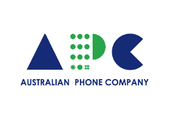
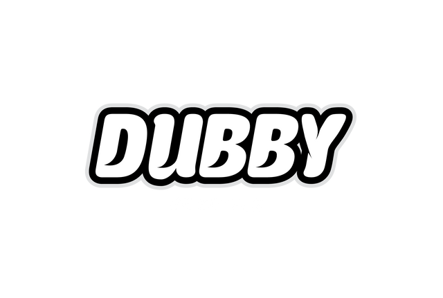

# NEXUS ENGINE

Copyright (c) 2026 Samrath Singh (sami9889). All rights reserved.

NEXUS ENGINE is a free, Unity-style game engine. Build 3D games with
GameObjects and components, a visual editor, a real software rasterizer
with PBR lighting, cloth physics, weather, water, terrain, and more.

**This repo is downloads only. The source code is closed and is not
in this repo.** Do not re-upload, redistribute, or copy the engine
files. Games you make with NEXUS ENGINE are yours. See `LICENSE` for
the full terms.

## Download

Get the latest release here:

https://github.com/Sami9889/NEXUS/releases

- **Linux:** `NEXUS-linux.tar.gz` (145 MB) - extract it and run `./NEXUS`.
  The `lib/` folder next to it has to stay next to the app.
  Direct link: https://github.com/Sami9889/NEXUS/releases/download/v1.0.0/NEXUS-linux.tar.gz
- **Linux (.deb):** `NEXUS-linux.deb` (122 MB) - installs to /opt, shows up
  in the app menu, and can be launched with `nexus` from a terminal.
  Direct link: https://github.com/Sami9889/NEXUS/releases/download/v1.0.0/NEXUS-linux.deb
- **Windows:** `NEXUS-Setup.exe` (87 MB).
  Direct link: https://github.com/Sami9889/NEXUS/releases/download/v1.0.0/NEXUS-Setup.exe
- **macOS:** `NEXUS-macOS.dmg` (154 MB).
  Direct link: https://github.com/Sami9889/NEXUS/releases/download/v1.0.0/NEXUS-macOS.dmg

Every download comes with the default GameProject, so the editor opens
with something to work on.

## About

NEXUS ENGINE is made by Samrath Singh, an independent software
engineer and tech creator based in Melbourne, Australia.

- Website: https://sami-s.dev
- Contact: hello@sami-s.dev

## Sponsors

Australian Phone Company is a sponsor of NEXUS ENGINE.

Dubby sponsors NEXUS ENGINE. Use code SAMI9889 for 10% off at [dubby.gg](https://www.dubby.gg/discount/SAMI9889?ref=doihgpyc).
